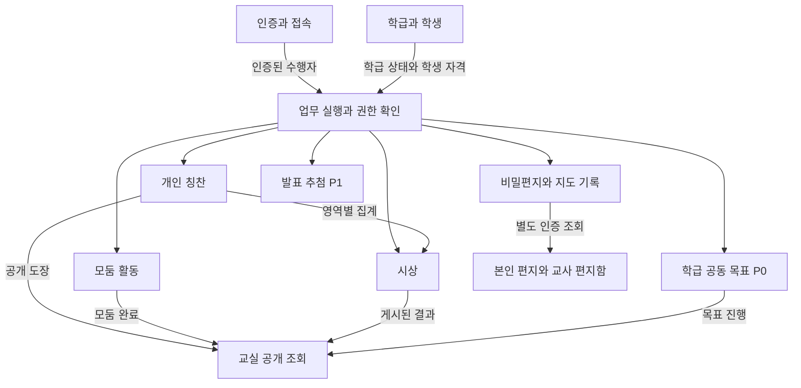

# 학급 경영 앱 도메인 정의

최신 변경(2026-10-14): [로그인·직접 적립 도메인 추가](./login-and-self-praise.md)를 우선 적용한다. identity의 학생 PIN·교사 인증과 praise의 DailyPraiseCode·DailyClaimUsage·BulkPraiseBatch를 추가한다. 학생 본인의 코드 검증 적립을 허용하며 일일 2회로 제한한다. 시상·편지 도메인은 현재 범위에서 제외한다.

버전 0.1 · 2026년 10월 12일 · PRD 0.1 기반 설계 제안

이 문서는 앱의 업무를 여덟 개 도메인으로 나누고, 각 도메인이 소유하는 데이터와 업무 규칙, 다른 도메인과의 연결을 정의한다. 교사 화면과 학생 화면은 같은 업무를 서로 다른 권한으로 사용하는 화면이므로 별도의 업무 도메인으로 나누지 않는다.

초기 구현은 하나의 애플리케이션과 데이터베이스 안에서 도메인별 모듈을 분리하는 **모듈형 모놀리스**로 제안한다. 여기서 도메인 분리는 서비스나 서버를 여덟 개 운영한다는 뜻이 아니다. 기술 스택, 배포 방식, 기존 PRD의 미확정 제품 정책은 이 문서로 확정되지 않는다.

관련 문서: [PRD](../학급경영_칭찬관리_PRD.md) · [폴더 구조와 의존 규칙](./folder-structure.md)

최신 확정 요구는 [학기별 칭찬판과 온도별 보상](./stamp-and-rewards.md)에 정의한다. 개인 각 30개, 모둠 각 15개, 온도계 0~100도·5도 단위와 20개 빈 보상란을 필수 기능으로 반영한다.

## 1 도메인 경계

도메인은 같은 데이터와 규칙이 함께 바뀌는 업무의 경계다. 예를 들어 칭찬을 취소하는 규칙은 칭찬 도메인이, 취소 이후 시상 초안을 다시 검토할지는 시상 도메인이 담당한다.

| 도메인 | 모듈명 | 책임 | 소유하지 않는 업무 | 우선순위 |
| --- | --- | --- | --- | --- |
| 인증과 접속 | identity | 본인 확인, 접속 코드, 세션, 재인증, 접속 해제 | 학급 명단, 모둠장 지정, 시상 기준 | P0 |
| 학급과 학생 | classroom | 학급, 학년도, 담당 교사, 학급별 학생 명단과 활성 상태 | 학생 비밀번호, 칭찬, 모둠 소속 | P0 |
| 개인 칭찬 | praise | 칭찬 영역, 기록, 취소, 날짜별 집계 | 수상자 결정, 온도계 증가 | P0 |
| 모둠 활동 | teams | 모둠, 소속 이력, 모둠장, 일별 점검 | 개인 칭찬 지급, 출결 관리 | P0 |
| 시상 | awards | 주간 회차, 추천 규칙, 후보, 승인, 게시, 정정 | 원본 칭찬 수정, 학생 신원 인증 | P0 |
| 비밀편지와 지도 기록 | correspondence | 편지 대화, 확인 상태, 답글, 교사 전용 지도 노트 | 공개 공지, 자동 상담, 감정 판정 | P0 |
| 발표 추첨 | participation | 수업별 추첨 대상과 결과, 중복 제외 | 출결 원장, 자동 칭찬 | P1 |
| 학급 공동 목표 | class-goals | 온도 주기, +5도 칭찬, 20개 보상란, 달성 상태 | 실물 보상, 개인 점수 환산 | P0 |

칭찬 소식, 교사 대시보드, 학생 홈, 교실 공개 화면은 위 도메인의 허용된 정보를 조합하는 조회 기능이다. 변경 이력, 저장소 연결, 암호화, 작업 재시도는 여러 도메인을 지원하는 공통 기반이다.

2026년 10월 13일 반영: 학급 첫 화면의 제목은 **우리 반 학급 규칙**이며, **자주적인 어린이 → 긍정적인 어린이 → 적극적인 어린이 → 배려하는 어린이** 순서로 표시한다. 규칙은 classroom의 학급 안내 정보로 소유하고, 첫 화면은 이를 보여주는 화면 계층으로 둔다. 초기 규칙은 네 문구를 기본값으로 제공하며 별도 도메인은 만들지 않는다. 규칙 문구는 praise의 네 칭찬 영역과 의미를 맞추되 데이터 소유권은 분리한다.

## 2 공통 용어와 식별자

| 용어 | 의미와 설계 원칙 |
| --- | --- |
| Account | 로그인 주체. 교사 또는 학급별 학생 신원과 연결되며 교육 기록 자체를 소유하지 않는다. |
| Actor | 서버에서 확인한 현재 요청 수행자. 요청 본문에 적힌 역할을 신뢰해 만들지 않는다. |
| Classroom | 한 학년도의 한 학급. 모든 학생 교육 기록의 접근 범위를 결정한다. |
| StudentEnrollment | 해당 학급에 등록된 학생 기록. 화면에는 학생으로 표현한다. 번호 변경·전출 후에도 ID는 유지한다. |
| studentId | 이 문서와 API에서 StudentEnrollment의 ID를 줄여 부르는 이름. 전교·전학년 공통 학생 ID가 아니다. |
| TeacherId | 교사 Account를 참조하는 식별자. 교사별 별도 교육 기록 복제본을 만들지 않는다. |
| LocalDate | Asia/Seoul 기준 달력 날짜. 행동 날짜와 모둠 점검 날짜에 사용한다. |
| Instant | 저장·확인·게시 등의 정확한 발생 시각. UTC로 저장하고 화면에서 변환한다. |
| PraiseCategory | SELF_DIRECTED, POSITIVE, ACTIVE, CONSIDERATE의 네 고정 코드. 화면 이름과 분리한다. |
| AwardPeriod | 주간 시상 기간. ISO 주차만 사용하지 않고 ISO 주차 연도 또는 월요일 날짜를 함께 저장한다. |
| Aggregate | 저장할 때 함께 검증하고 일관성을 유지하는 데이터 묶음. 모든 데이터를 한 객체에 넣는 의미는 아니다. |
| DomainEvent | 업무가 완료됐다는 사실. 실행하라는 명령과 구분한다. |

새 학년도에는 새 Classroom과 StudentEnrollment를 만든다. 기존 학생의 칭찬·편지를 새 학급으로 자동 이월하지 않는다. 같은 학생을 여러 학년에서 연결할 필요가 생기면 이후에 별도 정책과 데이터 모델을 검토한다.

모든 학생 관련 기록은 classroomId와 studentId의 조합을 검증한다. ID를 알고 있다는 이유만으로 읽거나 수정할 수 없다. 교실 공개 모드는 도메인 역할이 아니며, 공개 데이터만 조회할 수 있는 제한된 접속 범위다.

## 3 도메인별 상세 정의

### 3.1 인증과 접속 identity

**주요 모델**

- Account: id, kind, status, teacherProfile 또는 studentId 연결.
- StudentCredential: studentId, 코드 해시, PIN 해시, 발급·만료·폐기 시각, 인증 실패 상태.
- Session: accountId, 접속 범위, 만료 시각, 폐기 상태, 마지막 재인증 시각.

Account, StudentCredential, Session은 수명과 변경 빈도가 달라 각각 독립 저장 단위로 둔다. Account에 모든 과거 세션을 포함해 한 번에 저장하지 않는다.

**업무 규칙**

- 학생 접속 코드는 학생 등록과 연결되지만 인증 비밀은 classroom에 저장하지 않는다.
- 모둠장 여부를 세션의 영구 역할로 저장하지 않는다. 수정 요청 때 teams의 현재 지정 상태를 확인한다.
- 전출과 학급 보관 이후에는 기존 세션도 학생 데이터에 접근할 수 없다. 세션 폐기 작업뿐 아니라 요청 시 학급·학생의 현재 상태를 확인한다.
- 교사 재인증 여부는 서버가 검증한다. 브라우저의 잠금 해제 표시만으로 민감 데이터를 반환하지 않는다.
- 공개 모드의 접속 수단은 읽기 전용이며 편지·후보·지도 노트 권한을 갖지 않는다. 교사 관리 복귀에는 재인증이 필요하다.

**명령**: IssueStudentCredential, RotateStudentCredential, SignIn, Reauthenticate, RevokeSessions.

**이벤트**: StudentCredentialRotated, SessionsRevoked. 코드, PIN, 토큰은 이벤트에 넣지 않는다.

**검증 예시**: 폐기한 학생 코드로 로그인 실패. 학생 계정으로 교사 재인증 API 호출 거부. 전출 처리 후 기존 세션 조회 거부.

### 3.2 학급과 학생 classroom

**주요 모델**

- Classroom: id, ownerTeacherId, academicYear, name, timezone, status, version.
- StudentEnrollment: id, classroomId, number, displayName, status, enrolledAt, deactivatedAt, version.
- Semester: id, classroomId, label, startsOn, endsOn, status. 학급 내 기간 중복을 막고 개인·모둠 판의 학기 범위를 제공한다.

Classroom과 StudentEnrollment는 독립 저장 단위다. 학생 등록·전출처럼 학급 정원이나 번호 유일성에 영향을 주는 작업은 같은 트랜잭션에서 처리한다. 한 학급의 모든 칭찬과 편지를 Classroom 객체에 넣지 않는다.

**업무 규칙**

- 한 학급의 담당 교사는 한 명이다. 첫 출시에서 교사 양도를 지원하지 않는다.
- 활성 학생 번호는 학급 안에서 유일하며 기본 지원 정원은 PRD 제안인 40명이다.
- 이름과 번호가 바뀌어도 학생 ID는 유지한다.
- 학급 상태는 ACTIVE → ARCHIVED. 보관 후 학생 접속과 신규 업무 기록을 막고, 담당 교사의 조회·내보내기·삭제만 허용한다.
- 학생 상태는 ACTIVE → INACTIVE. 재활성화 기능은 미정이며 구현 전 번호 충돌과 접속 재발급 정책을 결정한다.
- 비활성화는 개인정보 영구 삭제와 다른 작업이다.

**명령**: CreateClassroom, RegisterStudent, UpdateStudent, DeactivateStudent, ArchiveClassroom.

**조회 계약**: ClassroomAccessView, ActiveRosterView, StudentEligibilityView. 다른 모듈에는 학생 전체 저장 모델 대신 필요한 필드만 반환한다.

**이벤트**: StudentRegistered, StudentProfileChanged, StudentDeactivated, ClassroomArchived.

**검증 예시**: 같은 학급에 같은 활성 번호 등록 거부. 동시 등록에도 정원 초과 차단. 번호 변경 후 기존 칭찬 연결 유지.

### 3.3 개인 칭찬 praise

**주요 모델**

- PraiseRecord: id, classroomId, studentId, category, occurredOn, recordedAt, recordedBy, status, requestId, cancellation.
- Cancellation: cancelledAt, cancelledBy, reason. 취소 정보는 PraiseRecord의 일부로 관리한다.
- PraiseCategory: 고정 코드와 표시 이름의 정의. 첫 출시에서 편집 가능한 독립 관리 도메인으로 만들지 않는다.

PersonalStampBoard는 학급·학기·학생·영역별로 하나이며 상한은 30이다. PraiseRecord는 boardId를 참조한다. 지급과 취소는 판 잠금 아래 유효 개수 검증과 함께 저장한다. 빈칸과 진행 수는 유효 기록으로 계산하고 임의로 수정 가능한 잔액을 만들지 않는다. 30개에서 추가 지급을 거부하고 새 학기에 별도 판을 생성한다.

**업무 규칙**

- 현재 담당 교사만 활성 학급의 활성 학생에게 칭찬을 생성한다.
- 서로 다른 요청은 같은 날·학생·영역이어도 별도 칭찬이다. 동일 requestId 재시도만 중복 방지한다.
- requestId는 수행자·학급·작업 종류 범위에서 유일하게 관리한다. 같은 키로 다른 내용을 보내면 충돌로 거부한다.
- 미래 행동 날짜는 허용하지 않는다. 과거 날짜 기록에는 이유를 요구하고 신규 기록의 날짜는 활성 학기 범위로 제한한다.
- 상태는 ACTIVE → CANCELLED이며 취소된 기록을 조용히 복구하거나 덮어쓰지 않는다. 취소 후 잘못된 취소를 바로잡으려면 새 기록을 만든다.
- 취소 사유와 수행자는 교사용 이력이다. 공개 칭찬 응답에는 포함하지 않는다.

**명령**: GrantPraise, CancelPraise.

**조회 계약**: PublicPraiseStampView, OwnPraiseSummaryView, TeacherPraiseHistoryView, AwardScoreInput.

**이벤트**: PraiseGranted, PraiseCancelled. 기록 ID, 학급 ID, 학생 ID, 영역과 날짜 등 필요한 최소 필드만 포함한다.

**검증 예시**: 동일 요청 세 번 전송 시 한 건. 다른 요청 두 건은 두 도장. 취소 후 공개 조회와 시상 집계에서 제외.

### 3.4 모둠 활동 teams

**주요 모델**

- Team: id, classroomId, name, status, version.
- TeamMembership: id, classroomId, teamId, studentId, validFrom, validUntil.
- LeaderAssignment: teamId, studentId, validFrom, validUntil. 과거 모둠장 이력 유지.
- DailyTeamCheck: id, classroomId, teamId, date, cleanupDone, taskDone, updatedBy, version.
- TeamStampBoard: 학급·학기·모둠·영역별 판, CLEANUP과 TASK_DONE 각각 상한 15.
- TeamPraiseRecord: boardId, occurredOn, recordedBy, requestId, status, cancellation. 교사가 지급·취소하며 모둠장의 점검 체크와 별도로 누적한다.

모둠 편성 변경은 Team, 소속 이력과 모둠장 지정을 함께 검증한다. 일별 체크는 별도 저장 단위로 두어 매번 전체 소속 이력을 저장하지 않는다.

**업무 규칙**

- 학생은 현재 최대 한 모둠에 소속된다. 모둠장은 현재 해당 모둠에 속한 활성 학생이어야 한다.
- 모둠당 현재 모둠장은 최대 한 명이다. 편성 중 또는 모둠장 전출 직후에는 미지정 상태를 허용하고 교사에게 지정 필요를 표시한다.
- 모둠장 미지정 상태에서 학생의 체크 수정은 불가능하고 교사 정정만 가능하다.
- 모둠과 날짜 조합의 DailyTeamCheck는 하나다. completed는 두 체크가 모두 참인지로 계산한다.
- 학생은 본인 모둠의 오늘 기록만 수정하고, 교사는 사유와 함께 과거 기록도 정정할 수 있다.
- 수정 시 version을 비교한다. 충돌한 요청은 최신 상태 확인 후 다시 수행한다.
- 소속 이동과 모둠장 해제는 원자적으로 처리한다. 전출 시 소속 종료와 모둠장 해제도 함께 수행한다.
- 학기별 두 칭찬판은 각각 15개를 넘지 않으며 지급·취소를 판 잠금으로 보호한다. 체크 날짜가 바뀌어도 도장은 유지한다. 모둠원 이동에 따라 도장을 개인에게 옮기지 않는다.

**명령**: CreateTeam, MoveTeamMember, AssignLeader, RemoveTeamMember, UpdateDailyCheck, CorrectDailyCheck, GrantTeamPraise, CancelTeamPraise.

**이벤트**: TeamMembershipChanged, TeamLeaderChanged, DailyTeamCheckUpdated.

**검증 예시**: 모둠 이동 동시 요청에도 현재 소속 하나 유지. 이전 모둠장의 수정 거부. 자정 이후 새 날짜의 미완료 상태 표시.

### 3.5 시상 awards

**주요 모델**

- AwardRound: id, classroomId, weekStart, currentPublishedRevisionId, withdrawnAt, version.
- AwardRevision: roundId, revisionNo, reviewStatus, eligibilityStatus, cutoffAt, policyVersion, sourceVersions, tieSeed, categoryOrder, selections.
- AwardSelection: category, studentId 또는 미선정, scoreSnapshot, recentAwardFlag, recommendationReason, overrideReason.
- AwardPolicy: 최근 14일, 동점 순서, 1인 1상, 영역 순환 등 순수한 추천 규칙.

한 회차의 편집 중 버전과 그 버전에 속한 최대 네 개 선정 결과는 함께 검증한다. 이미 게시한 버전은 불변으로 보관하며 정정 초안을 만들더라도 기존 공개 버전은 정정 게시 전까지 유지한다. 회차의 모든 역사 버전을 매번 한 객체로 로드할 필요는 없다.

**업무 규칙**

- 학급과 대상 주 조합당 회차 하나를 만든다. 철회 후 재게시도 같은 회차의 새 버전으로 처리한다.
- 한 버전 안에서 영역별 최대 한 명, 학생별 최대 한 부문을 보장한다. 미선정은 studentId가 없는 명시적 결과다.
- 추천 정책은 PRD F05를 따른다. 최근 수상 구간은 기준일 D에 대해 [D-14일 00시, D 00시)이며 서울 시간 기준이다.
- 월요일 시작부터 토요일 00시 미만으로 주간 경계를 표현한다. 금요일 이전 실행에서는 실제 집계 마감 시각을 사용한다. 이는 PRD의 금요일 종료를 소수초 누락 없이 구현하기 위한 표현이다.
- 원본 칭찬은 수정하지 않는다. 집계값과 추천 근거, 난수 시드, 규칙 버전을 복사해 결과를 설명할 수 있게 한다.
- 같은 입력 스냅샷과 규칙 버전, 시드는 항상 같은 추천 결과를 만든다.
- 동점 시드는 회차 최초 추천 때 생성하고 재추천·새로고침에서도 유지한다. 자료 변경으로 새 버전을 만들더라도 임의로 시드를 바꿔 결과를 다시 뽑지 않는다.
- 수동 교체는 이유가 필요하며 1인 1상은 계속 적용한다.
- 공개 대상은 회차가 가리키는 최신 게시 버전이다. 초안, 점수, 최근 수상 이력, 교사 변경 이유는 공개하지 않는다.
- 최근 수상 판단에서 정정 버전은 중복 수상으로 세지 않는다. 원래 게시일을 보존하고 철회된 회차는 제외하는 안을 제안한다. 이 규칙은 PRD 보완 정책으로 확인이 필요하다.

**상태를 분리해 관리**

| 상태 축 | 값 | 의미 |
| --- | --- | --- |
| 검토 상태 | DRAFT, REVIEWED, PUBLISHED | 작성·교사 검토·공개 여부 |
| 자료 유효성 | CURRENT, STALE | 최신 원본 자료와 일치하는지 |
| 회차 공개 상태 | 미게시, 게시 중, 철회 | 공개 버전 포인터와 철회 시각으로 판단 |

REVIEWED이더라도 STALE이면 게시할 수 없다. 정정 초안이 생겼다는 이유로 기존 게시 결과를 비공개로 만들지 않는다. 철회는 과거 이력을 지우지 않으며 후속 추천에서 유효 수상으로 사용하지 않는다.

**명령**: GenerateRecommendation, OverrideSelection, MarkReviewed, PublishRevision, StartCorrection, WithdrawAwardRound.

**조회 계약**: TeacherAwardReviewView, PublishedAwardView. 학생용 DTO에 후보 근거를 선택적으로 숨기는 방식 대신 서로 다른 DTO를 사용한다.

**이벤트**: AwardDraftGenerated, AwardRevisionPublished, AwardRoundWithdrawn. 공개 알림에는 게시 ID 등 공개 가능한 필드만 사용한다.

**검증 예시**: 동점 재계산 재현. 칭찬 변경 후 게시 차단. 동시에 게시와 칭찬 취소가 실행돼도 오래된 초안 게시 차단. 정정 중 기존 수상 결과 유지.

### 3.6 비밀편지와 지도 기록 correspondence

**주요 모델**

- LetterThread: id, classroomId, studentId, createdAt, version.
- LetterMessage: id, threadId, senderKind, body, submittedAt, acknowledgedAt.
- TeacherNote: id, classroomId, studentId, teacherId, optionalThreadId, body, createdAt, updatedAt, version.

대화는 학생이 편지를 제출할 때 새로 만들고 같은 대화에 후속 글과 답글을 추가한다. 메시지는 누적되지만 조회는 페이지 단위로 한다. 지도 노트는 별도 저장 단위이며 학생용 메시지와 테이블·조회 계약을 분리한다.

**업무 규칙**

- 학생 본인과 담당 교사만 대화를 조회한다. 교사는 유효한 재인증 상태여야 한다.
- 학생 제출 메시지의 본문은 불변이다. 추가 설명은 새 메시지로 남긴다.
- 교사의 목록·본문 조회만으로 읽음 처리하지 않는다. 명시적인 확인 명령이나 답글 제출로 확인 시각을 기록한다.
- 답글 제출 시 그 시점에 존재하는 미확인 학생 메시지를 같은 트랜잭션에서 확인 처리한다. 그 뒤 도착한 새 글은 미확인으로 남는다.
- 보내짐·확인됨·답장 도착 상태는 각 메시지의 시각에서 계산한다. 새 글을 보낸 대화를 계속 과거의 답장 완료 상태로만 표시하지 않는다.
- 지도 노트 생성은 편지를 이동·삭제하는 작업이 아니다. 원래 편지를 참조하는 별도 교사 전용 기록이다.
- 편지 본문, 지도 노트, 답글을 일반 변경 로그·이벤트·분석에 복제하지 않는다.
- 학급 보관 이후 신규 편지와 답글, 노트 작성을 막는다. 보관 데이터의 교사 조회·내보내기·삭제는 허용한다.

**명령**: SubmitLetter, AppendStudentMessage, AcknowledgeMessages, ReplyToLetter, CreateTeacherNote, UpdateTeacherNote.

**조회 계약**: OwnLetterThreadView, TeacherInboxView, TeacherNoteView. PublicView는 제공하지 않는다.

**이벤트**: LetterSubmitted, MessagesAcknowledged, TeacherReplied. 식별자 위주로 구성하며 편지 알림도 해당 학생·교사 전용 채널만 사용한다.

**검증 예시**: URL의 학생 ID 변경으로 다른 대화 접근 불가. 지도 노트가 학생 응답에 없는지 검증. 답글 직후 새 학생 메시지는 미확인.

### 3.7 발표 추첨 participation

**주요 모델**: DrawSession(classroomId, teacherId, openedAt, endedAt), DrawResult(sessionId, eligibleStudentIds, selectedStudentIds, requestedCount, drawnAt).

**업무 규칙**: 활성 학생 중 교사가 포함한 대상만 추첨한다. 한 번에 중복 없이 N명을 뽑으며 대상 수보다 큰 N은 거부한다. 이미 뽑힌 학생 제외는 수업 세션 범위다. 추첨 당시 후보와 결과를 보존한다. 추첨 결과를 받은 뒤 칭찬을 줄 때는 학생 활성 상태를 다시 확인한다.

**명령**: StartDrawSession, DrawStudents, ResetDrawSession.

**이벤트**: StudentsDrawn. 이 이벤트를 받아 자동 칭찬을 지급하는 구독자는 만들지 않는다.

### 3.8 학급 공동 목표 class-goals

**주요 모델**: GoalCycle(id, classroomId, title, target=100, step=5, currentValue, status, version), TemperatureChange(cycleId, delta, reason, createdBy, createdAt, reversesChangeId), RewardMilestone(cycleId, temperature, rewardText, version).

교사의 학급 전체 칭찬만 +5도를 생성한다. 각 주기의 보상은 5도부터 100도까지 5도 간격의 20개이며 초기 rewardText는 전부 빈 문자열이다. 학생과 정한 내용을 교사가 편집하며 빈 내용도 허용한다. `(cycleId, temperature)`는 유일하고 온도 단계는 고정한다. 내용이 비어 있어도 칭찬을 허용하며 실제 보상 지급을 자동 실행하지 않는다.

**업무 규칙**: 학급에 현재 목표 주기는 최대 하나다. 값은 0 이상 목표값 이하다. currentValue는 같은 트랜잭션으로 저장된 유효 변동의 합과 일치해야 한다. 취소는 원래 변동을 지우지 않고 상쇄 변동을 추가하며 같은 변동을 두 번 취소하지 않는다. 값이 목표 미만으로 내려가면 현재 달성 상태도 해제하되, 해당 주기의 축하 연출 중복 여부는 별도 이력으로 유지한다. 새 목표는 기존 주기를 보관하고 새 주기를 만든다.

**명령**: StartGoalCycle, IncreaseTemperature, ReverseTemperatureChange, StartNextGoalCycle, UpdateRewardMilestone.

**이벤트**: TemperatureChanged, GoalReached, GoalCycleStarted. 개인 칭찬이나 모둠 완료 이벤트와 자동 연결하지 않는다.

## 4 도메인 관계

아래 화살표는 제공자가 소비자에게 제공하는 정보의 방향이다. 코드 import 방향은 폴더 구조 문서에서 별도로 정의한다.

비밀편지는 공개 조회와 연결하지 않는다. 시상은 칭찬의 집계 계약을 사용하고 칭찬 테이블을 직접 수정하지 않는다. 추첨과 온도계는 다른 보상 데이터에 자동으로 영향을 주지 않는다.

## 5 주요 데이터 관계

| 관계 | 수량 | 소유와 참조 원칙 |
| --- | --- | --- |
| 교사 Account → Classroom | 1 대 N | Classroom은 담당 교사 ID만 참조 |
| Classroom → StudentEnrollment | 1 대 N | 명단은 classroom 소유 |
| StudentEnrollment → StudentCredential | 1 대 N 이력 | identity 소유, 유효 접속 수단 정책 별도 적용 |
| StudentEnrollment → PraiseRecord | 1 대 N | praise 소유 |
| StudentEnrollment → TeamMembership | 1 대 N 이력 | teams 소유, 현재 소속 최대 하나 |
| Team → DailyTeamCheck | 1 대 N | 날짜당 한 건 |
| Semester → PersonalStampBoard | 1 대 N | 학생·영역당 30칸 |
| Semester → TeamStampBoard | 1 대 N | 모둠·영역당 15칸 |
| GoalCycle → RewardMilestone | 1 대 20 | 5~100도, 기본 내용 빈칸 |
| Classroom → AwardRound | 1 대 N | 주당 한 회차 |
| AwardRound → AwardRevision | 1 대 N | 게시 버전은 불변 |
| AwardRevision → AwardSelection | 1 대 4 | 영역당 한 행, 미선정 허용 |
| StudentEnrollment → LetterThread | 1 대 N | correspondence 소유 |
| LetterThread → LetterMessage | 1 대 N | 본인 및 담당 교사 제한 |
| StudentEnrollment → TeacherNote | 1 대 N | 학생용 조회에 포함하지 않음 |
| Classroom → GoalCycle | 1 대 N | 현재 주기 최대 하나 |

하나의 DB를 사용하더라도 데이터의 소유 모듈은 하나로 정한다. 도메인 간 ID 참조와 무결성 제약은 사용할 수 있지만, 다른 모듈의 내부 저장소를 직접 호출해 업무를 우회하지 않는다.

**저장소에서 함께 보장할 제약**

| 데이터 | 필요한 제약 |
| --- | --- |
| 학생 등록 | 활성 행에 대해 classroomId와 number 조합 유일 |
| 학생 관련 기록 | classroomId와 studentId가 동일 학급의 학생 등록을 참조하도록 복합 참조 또는 동등한 검증 적용 |
| 칭찬 요청 | classroomId, 수행자, 작업 종류, requestId 조합 유일; 원래 요청 내용의 해시를 함께 비교 |
| 현재 모둠 소속 | 종료되지 않은 소속에서 classroomId와 studentId 조합 유일 |
| 현재 모둠장 | 종료되지 않은 지정에서 teamId 유일; 현재 모둠 소속 여부는 트랜잭션에서 추가 검증 |
| 모둠 점검 | teamId와 date 조합 유일; 수정 시 version 비교 |
| 시상 회차 | classroomId와 weekStart 조합 유일 |
| 시상 버전과 결과 | roundId와 revisionNo 조합 유일; revisionId와 category 조합 유일; 미선정이 아닌 studentId는 revisionId 안에서 유일 |
| 현재 공동 목표 | 종료되지 않은 주기에서 classroomId 유일; 현재값은 0 이상 목표값 이하 |

조건부 유일성 제약의 구체적 문법은 선택할 DB에 맞춘다. 정원 제한, 모둠장의 현재 소속, 최신 자료 기반 시상처럼 여러 행을 함께 읽어야 하는 규칙은 단일 필드 제약만으로 해결하지 않고 트랜잭션 검증을 병행한다.

## 6 업무 실행과 트랜잭션

### 6.1 칭찬 생성

1. 서버 진입점에서 요청 형식과 세션을 검증한다.
2. 업무 실행 계층에서 담당 교사, 활성 학급·학생 여부를 확인한다.
3. praise가 날짜·영역·중복 요청을 검증한다.
4. 하나의 DB 트랜잭션에서 칭찬, 요청 처리 결과, 변경 메타데이터, 시상 자료 버전을 반영한다.
5. 커밋 이후 허용된 채널에 갱신을 알린다. 알림 실패로 칭찬 저장이 취소되지는 않는다.

### 6.2 시상 추천과 게시의 일관성

초안의 최신 여부는 비동기 이벤트 수신 여부만으로 판단하지 않는다. 이벤트가 늦거나 빠져도 오래된 자료가 게시되지 않아야 한다.

- classroom의 후보 자격 버전, praise의 집계 자료 버전, awards의 수상 이력 버전을 저장한다. 각 버전은 소유 모듈이 해당 업무 변경과 같은 트랜잭션에서 증가시킨다.
- 추천 시 일관된 읽기 스냅샷에서 버전과 집계 자료를 함께 읽고 AwardRevision에 저장한다.
- 게시 시 학급 단위의 트랜잭션 잠금 아래 현재 버전과 초안 버전을 비교하고, 검토 완료·중복 수상 제약을 확인한 뒤 공개 버전 포인터를 바꾼다.
- 같은 자료에 영향을 주는 칭찬 변경·학생 활성 변경·수상 게시 및 철회도 동일한 학급 잠금 규약을 따른다. 비교 후 커밋 직전 다른 쓰기가 끼어드는 문제를 방지한다.
- 게시 작업 자체가 증가시킨 수상 이력 버전은 방금 게시한 결과를 무효화하지 않는다. 초안 재검토 판단에 사용하는 게시 전 버전과 게시 후 버전을 구분한다.
- 초기에 학급 전체의 관련 버전을 보수적으로 비교할 수 있다. 관련 없는 기간 변경에도 재검토를 요구할 수 있다는 비용을 기록한다. 필요하면 이후 기간별 버전으로 좁힌다.

### 6.3 전출 처리

업무 조정 계층이 classroom의 비활성화, teams의 현재 소속 종료·모둠장 해제, identity의 학생 접속 폐기를 한 트랜잭션으로 실행한다. 각 모듈의 공개 명령을 호출하며 다른 모듈 테이블을 직접 갱신하지 않는다. 외부 인증 제공자 폐기 등 DB 밖의 작업이 실패해도 서버의 현재 학생 상태 검사로 즉시 접근을 막고 외부 폐기는 재시도한다.

### 6.4 알림과 이벤트

이벤트는 화면 갱신과 후속 작업에 사용한다. 저장과 반드시 함께 남겨야 하는 후속 작업은 DB outbox에 같은 트랜잭션으로 기록하고 커밋 이후 처리하는 방식을 제안한다. 메시지 브로커나 별도 서비스 배포는 필수 조건이 아니다. 소비자는 eventId로 중복 실행을 막는다.

공개 채널, 학생 개인 채널, 교사 개인 채널은 인증과 payload를 분리한다. 편지 이벤트를 학급 전체 채널에 발행하지 않는다. 실시간 연결이 실패하면 새 조회로 현재 상태를 복원한다.

### 6.5 내보내기와 영구 삭제

privacy-workflows가 여러 모듈의 내보내기·삭제 계약을 순서대로 호출한다. 데이터의 보관·삭제 정책은 이 계층에서 조정하고 실제 레코드 처리는 소유 모듈이 담당한다. 일반 취소 이벤트를 영구 삭제로 오해하지 않는다. 편지와 지도 노트 내보내기는 별도 권한과 선택을 요구한다. 백업·outbox·로그·파일의 만료도 확정된 정책에 포함한다.

## 7 반드시 지킬 경계

1. 클라이언트의 역할 값과 classroomId를 믿지 않고 서버에서 현재 수행자의 권한을 검증한다.
2. 칭찬의 진실은 PraiseRecord, 시상 공개의 진실은 게시 버전, 비밀편지의 진실은 LetterMessage다.
3. 공개 화면은 공개 DTO만 읽는다. 민감 데이터를 받은 뒤 UI에서 숨기지 않는다.
4. domain에는 DB 드라이버, HTTP, 프레임워크, 브라우저 코드를 넣지 않는다.
5. 모듈 간 연결은 공개 계약과 업무 조정 계층을 통한다. 다른 모듈의 repository나 entity 내부를 import하지 않는다.
6. 업무상 동시에 보장해야 하는 규칙은 트랜잭션과 DB 제약으로 지키고, 이벤트 알림에만 맡기지 않는다.
7. 공유 폴더에 Student, PraiseRecord, LetterMessage 같은 업무 모델을 모으지 않는다. 소유 모듈에 둔다.

## 8 PRD 추적과 추가 결정 사항

| PRD 요구 | 담당 도메인 또는 계층 | 핵심 검증 위치 |
| --- | --- | --- |
| F01 인증·학급 | identity, classroom, lifecycle-workflows | 세션·학급 경계·전출 통합 검증 |
| F02 칭찬 | praise | 중복 요청·날짜·취소 규칙 |
| F03 학생판·공개 화면 | 공개 조회 조합, 각 도메인 DTO | 공개 payload와 접근 권한 검증 |
| F04 모둠 | teams | 소속 유일성·모둠장·충돌 |
| F05 시상 | awards, award-workflows | 알고리즘·스냅샷·동시 게시 |
| F06 편지 | correspondence, identity | 메시지 상태·교사 재인증·본문 비노출 |
| F07 발표 | participation | 대상 자격·중복 없는 추첨 |
| F08 온도계 | class-goals | 변동 합계·취소·주기 |
| 보관·내보내기·삭제 | privacy-workflows, 각 소유 모듈 | 범위·권한·복구 이후 재삭제 |

이 문서에서 추가한 정책 중 확인할 사항은 다음과 같다. 확인 전에는 제안으로 취급한다.

- 모둠장이 전출하면 미지정 상태를 허용하고 교사가 다시 지정한다.
- 시상 정정은 새 버전을 만들되 최근 수상 기준일은 원래 게시일로 유지한다.
- 답글은 그 시점까지 존재하는 학생 메시지를 확인 처리하며 이후 새 글은 미확인으로 둔다.
- 온도 증가 취소로 목표 미만이 되면 달성 상태를 해제하되 축하 연출은 같은 주기에서 반복하지 않는다.
- 학급별 학생 등록을 기준으로 ID를 만들고 학년 간 자동 통합 학생 프로필은 만들지 않는다.
