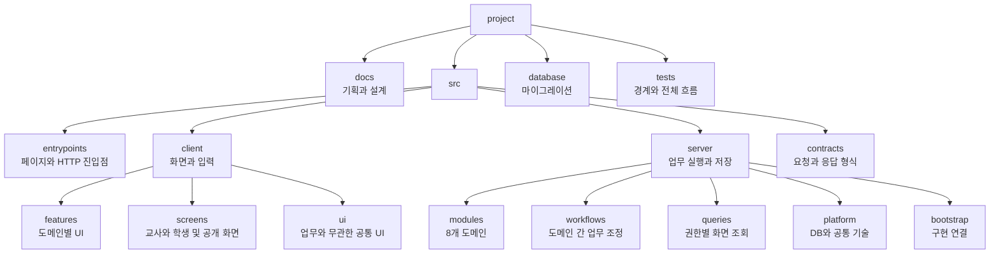
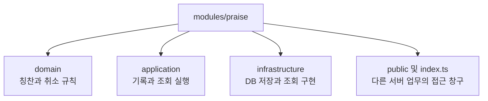
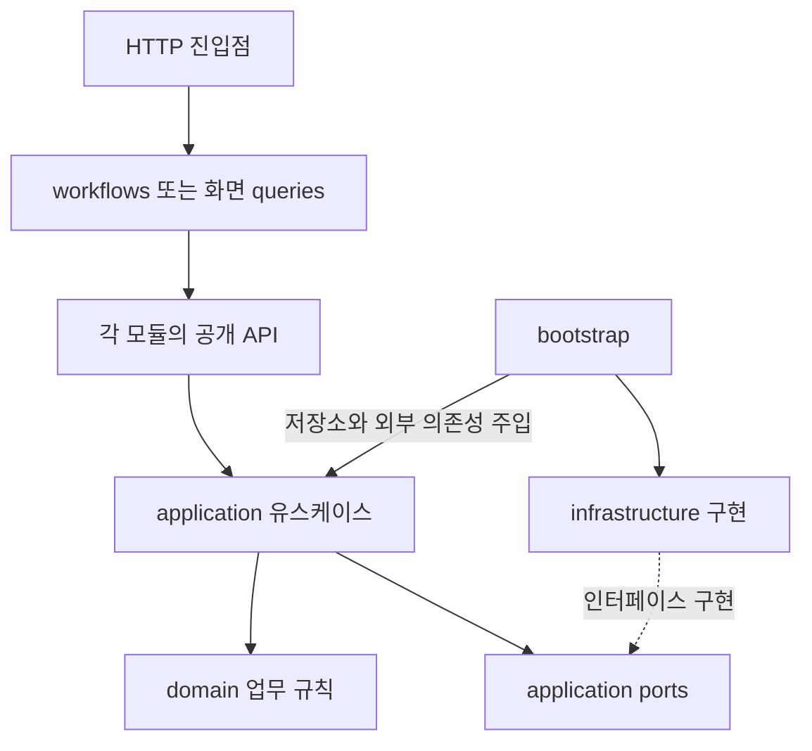

# 학급 경영 앱 폴더 구조와 의존 규칙

최신 변경(2026-10-14): [로그인·직접 적립 폴더 추가안](./login-and-self-praise.md)을 우선 적용한다. identity에 PIN·교사 로그인·재설정, praise에 날짜별 코드·일일 사용량·직접 적립·일괄 지급 유스케이스를 둔다. 시상·편지 관련 경로는 현재 구현 범위에서 제외한다.

버전 0.1 · 2026년 10월 12일 · 구현 전 구조 제안

이 문서는 [도메인 정의](./domain-model.md)의 여덟 업무 경계를 실제 개발 폴더에 대응시킨다. 현재 작업 공간에는 PRD와 설계 문서만 있으며, 아래 src 구조는 **제안 구조**다. 실행 가능한 앱이나 빈 코드 파일을 생성했다는 의미가 아니다.

설명용 파일명은 TypeScript를 가정한다. 특정 프레임워크, ORM, 인증 제품은 확정하지 않았다. 실제 프레임워크가 정해지면 entrypoints의 라우트 파일 규약만 조정하고 도메인 모듈 경계는 유지할 수 있다.

최신 상세 요구는 [학기별 칭찬판과 보상](./stamp-and-rewards.md)에 따른다. classroom에 Semester, praise에 PersonalStampBoard, teams에 TeamStampBoard·TeamPraiseRecord, class-goals에 RewardMilestone을 둔다. 개인 판은 영역별 30칸, 모둠 판은 영역별 15칸이며 온도계와 보상표는 P0다.

## 1 구조의 기본 원칙

- 최상위 업무 분류는 identity, classroom, praise, teams, awards, correspondence, participation, class-goals로 통일한다.
- server/modules는 검증과 저장을 담당하고 client/features는 해당 업무의 화면과 상호작용을 담당한다.
- 학급 첫 화면·교사 홈·학생 홈·교실 공개 화면은 기능과 안내를 조립하므로 client/screens에 둔다. 학급 진입 시 `classroom-welcome`에서 우리 반 학급 규칙 네 문구를 먼저 보여준다.
- API가 사용하는 데이터 형식은 contracts에 둔다. 서버 내부 엔티티를 브라우저에 그대로 전달하지 않는다.
- UI 컴포넌트와 저장소 구현을 각각 도메인 가까이에 둔다. 모든 업무를 최상위 components, services, repositories에 뒤섞지 않는다.
- 모든 도메인에 복잡한 하위 폴더를 미리 만들 필요는 없다. 파일이 몇 개뿐이면 같은 책임의 파일을 가까이 두고 커질 때 나눈다.

## 2 전체 폴더 다이어그램



위 화살표는 폴더의 포함 관계다. 코드 호출·의존 방향을 의미하지 않는다.

## 3 상세 디렉터리 트리

```text
project/
├─ 학급경영_칭찬관리_PRD.md
├─ docs/
│  ├─ domain-model.md
│  ├─ folder-structure.md
│  └─ decisions/                         # 기술·정책 결정 기록, 필요할 때 추가
├─ src/
│  ├─ entrypoints/                       # 프레임워크 규약에 맞춰 변환할 경계
│  │  ├─ pages/
│  │  │  ├─ teacher/                     # 교사 화면 진입
│  │  │  ├─ student/                     # 학생 화면 진입
│  │  │  └─ display/                     # 교실 공개 화면 진입
│  │  └─ http/
│  │     ├─ identity/
│  │     ├─ classroom/
│  │     ├─ praise/
│  │     ├─ teams/
│  │     ├─ awards/
│  │     ├─ correspondence/
│  │     ├─ participation/               # P1에서 추가
│  │     ├─ class-goals/                 # P0 온도계와 보상표
│  │     └─ display/                     # 공개 전용 조회 endpoint
│  ├─ client/
│  │  ├─ screens/                       # 여러 기능을 조립하는 화면
│  │  │  ├─ classroom-welcome/          # 우리 반 학급 규칙과 역할별 메뉴
│  │  │  ├─ teacher-dashboard/
│  │  │  ├─ student-home/
│  │  │  └─ classroom-display/          # 편지 UI나 교사 캐시를 import하지 않음
│  │  ├─ features/                      # 도메인별 UI와 클라이언트 상태
│  │  │  ├─ identity/
│  │  │  ├─ classroom/
│  │  │  ├─ praise/
│  │  │  ├─ teams/
│  │  │  ├─ awards/
│  │  │  ├─ correspondence/
│  │  │  ├─ participation/              # P1
│  │  │  └─ class-goals/                # P0
│  │  ├─ ui/                           # Button, Dialog, EmptyState 등
│  │  └─ transport/                    # HTTP 호출, 연결 복구, 공통 오류 변환
│  ├─ contracts/                       # 클라이언트와 서버가 공유할 전송 형식
│  │  ├─ identity/
│  │  ├─ classroom/
│  │  ├─ praise/
│  │  ├─ teams/
│  │  ├─ awards/
│  │  ├─ correspondence/               # 편지 DTO, 교사 전용 노트 DTO 분리
│  │  ├─ participation/                # P1
│  │  ├─ class-goals/                   # P0
│  │  └─ display/                      # 공개용 허용 필드만 정의
│  └─ server/                          # 브라우저 번들에서 접근 금지
│     ├─ modules/
│     │  ├─ identity/
│     │  ├─ classroom/
│     │  ├─ praise/
│     │  ├─ teams/
│     │  ├─ awards/
│     │  ├─ correspondence/
│     │  ├─ participation/             # P1
│     │  └─ class-goals/               # P0
│     ├─ workflows/
│     │  ├─ praise-workflows.ts        # 학급 자격 확인 후 칭찬 명령 실행
│     │  ├─ award-workflows.ts         # 추천 입력 수집, 버전 비교, 게시
│     │  ├─ team-workflows.ts          # 현재 명단·권한과 모둠 명령 연결
│     │  ├─ correspondence-workflows.ts # 재인증·현재 학급 상태 확인
│     │  ├─ lifecycle-workflows.ts     # 전출, 보관, 접속 폐기
│     │  └─ privacy-workflows.ts       # 내보내기와 영구 삭제 조정
│     ├─ queries/
│     │  ├─ teacher-dashboard.query.ts
│     │  ├─ student-home.query.ts
│     │  └─ classroom-display.query.ts # 공개 계약만 조합
│     ├─ platform/
│     │  ├─ database/                 # 연결, 트랜잭션, 학급 단위 잠금
│     │  ├─ audit/                    # 본문 없는 공통 변경 메타데이터
│     │  ├─ outbox/                   # 커밋 이후 작업과 재시도
│     │  ├─ realtime/                 # 공개·개인 채널 전달 기반
│     │  ├─ crypto/                   # 해시·암호화 구현, 비밀값은 코드 밖
│     │  └─ observability/            # 오류·성능 계측, 민감 본문 제외
│     ├─ kernel/                      # Clock, IdGenerator, 기본 Result만
│     └─ bootstrap/
│        ├─ composition-root.ts       # 저장소·인증·유스케이스 구현 연결
│        └─ event-handlers.ts         # 허용된 후속 작업 등록
├─ database/
│  ├─ migrations/                      # DB 전체 적용 순서가 있는 변경 파일
│  └─ seeds/                           # 가상 학급과 학생만 사용
└─ tests/
   ├─ architecture/                    # 모듈 간 import·공개 화면 경계
   ├─ integration/                     # 트랜잭션, 중복 요청, 동시성
   ├─ security/                        # 학생·학급·공개·편지 권한
   └─ e2e/                             # 교사 기록에서 학생 확인까지
```

database/migrations는 한 DB의 적용 순서를 보장하기 위해 중앙에 둔다. 각 파일명에 소유 도메인을 표시한다. 예를 들어 `0003_praise_records.sql`이다. 업무 규칙과 저장소 코드는 해당 모듈에 남긴다. ORM을 정하면 스키마 파일 배치는 그 도구의 제약에 맞추되 테이블 소유권은 유지한다.

## 4 도메인과 폴더의 대응

| 업무 도메인 | 서버 폴더 | 주요 모델 | 클라이언트 UI 예 |
| --- | --- | --- | --- |
| 인증 | server/modules/identity | Account, Credential, Session | StudentSignIn, ReauthDialog |
| 학급 | server/modules/classroom | Classroom, StudentEnrollment | RosterEditor, StudentCard |
| 칭찬 | server/modules/praise | PraiseRecord | QuickPraisePanel, StampBoard |
| 모둠 | server/modules/teams | Team, Membership, DailyTeamCheck | TeamCheckBoard, LeaderSelector |
| 시상 | server/modules/awards | AwardRound, AwardRevision | RecommendationReview, PublishedAwards |
| 편지 | server/modules/correspondence | LetterThread, LetterMessage, TeacherNote | LetterComposer, TeacherInbox |
| 발표 | server/modules/participation | DrawSession, DrawResult | StudentDrawPanel |
| 공동 목표 | server/modules/class-goals | GoalCycle, TemperatureChange | ClassThermometer |

추가 파일은 각 모듈의 `domain/semester.ts`, `domain/personal-stamp-board.ts`, `domain/team-stamp-board.ts`, `domain/team-praise-record.ts`, `domain/reward-milestone.ts`에 둔다. 클라이언트에는 영역별 StampBoard, TeamStampBoard, RewardScheduleEditor를 해당 도메인에 배치하고 학기·지급 상한·보상 빈칸 검증은 서버에서 수행한다.

클라이언트 UI 예시는 `client/features/<도메인>/components/`에 둔다. 일반 StudentCard는 학급 표시만 담당하고, 칭찬 동작은 QuickPraisePanel이 카드와 조합한다. StudentCard에 편지·시상·모둠 로직을 계속 추가하지 않는다.

첫 화면은 `client/screens/classroom-welcome/`에서 구성하고 규칙 표시 UI는 `client/features/classroom/components/ClassRules.tsx`에 둔다. 규칙 기본값은 classroom 모듈이 제공하고 `contracts/classroom/`의 안내 응답으로 전달한다. 네 문구는 자주적인 어린이, 긍정적인 어린이, 적극적인 어린이, 배려하는 어린이 순서다. 화면에 칭찬 영역 목록을 그대로 재사용하지 않는다.

## 5 한 도메인 내부의 표준 구조

칭찬 도메인을 예로 들면 다음과 같다. 레이어의 책임은 다른 모듈에도 적용하되 불필요한 빈 폴더는 만들지 않는다.

```text
server/modules/praise/
├─ domain/
│  ├─ praise-record.ts                 # 생성·취소 상태와 불변 조건
│  ├─ praise-category.ts               # 네 영역 코드
│  ├─ praise-errors.ts                 # 미래 날짜, 이미 취소됨 등
│  └─ praise-record.test.ts            # 순수 업무 규칙 검증
├─ application/
│  ├─ grant-praise.ts                  # 기록 사용 사례 실행
│  ├─ cancel-praise.ts                 # 취소 사용 사례 실행
│  ├─ get-public-stamps.ts             # 공개용 필드만 조회
│  ├─ get-teacher-history.ts           # 교사용 기록과 취소 이력
│  ├─ get-award-score-input.ts         # 시상용 집계 제공
│  └─ ports/
│     ├─ praise-repository.ts          # 필요한 저장 기능의 인터페이스
│     └─ praise-read-store.ts          # 공개·개인·시상 조회 인터페이스
├─ infrastructure/
│  ├─ sql-praise-repository.ts         # DB 구현
│  ├─ sql-praise-read-store.ts         # 허용된 필드를 선택하는 조회 구현
│  └─ praise-row-mapper.ts             # DB 행과 도메인 모델 변환
├─ public/
│  ├─ praise-api.ts                    # 다른 서버 업무가 부를 수 있는 계약
│  ├─ praise-events.ts                 # 필요한 최소 이벤트 형식
│  └─ praise-views.ts                  # 서버 간 전달용 집계·조회 형식
└─ index.ts                            # 공개 API와 형식만 export
```



public은 서버 모듈 사이의 공개 계약이라는 의미이며 인터넷 공개 API를 뜻하지 않는다. 브라우저는 이 폴더를 import하지 않는다. HTTP 요청·응답 형식은 src/contracts에 별도로 둔다.

### 클라이언트의 대응 구조

```text
client/features/praise/
├─ components/
│  ├─ QuickPraisePanel.tsx
│  ├─ StampBoard.tsx
│  └─ PraiseSaveStatus.tsx
├─ model/
│  └─ quick-praise-state.ts            # 선택 영역, 저장 중, 실패 상태
├─ api/
│  └─ praise-client.ts                # HTTP를 통해 호출
└─ index.ts                           # 화면에서 사용할 UI만 export

contracts/praise/
├─ grant-praise.contract.ts            # 요청과 응답, 요청 식별자
├─ public-stamp.contract.ts            # 날짜·영역·개수, 비공개 필드 없음
└─ teacher-history.contract.ts         # 교사 전용 이력 응답
```

서버의 미래 날짜 제한, 중복 요청 방지, 교사 권한 검증은 클라이언트로 옮기지 않는다. UI가 같은 입력을 미리 검사할 수는 있지만 최종 판정은 서버가 한다.

## 6 시상과 비밀편지의 추가 분리

시상은 정책 변경이 잦고, 비밀편지는 열람 경계가 중요하므로 내부 역할을 더 명확히 나눈다.

```text
server/modules/awards/
├─ domain/
│  ├─ award-round.ts
│  ├─ award-revision.ts
│  └─ policies/
│     ├─ candidate-ranking.ts          # 최근 수상·점수·동점 순서
│     ├─ category-order.ts             # 주차별 영역 순환
│     └─ recommendation-engine.ts      # 입력 스냅샷 → 후보, DB 접근 없음
├─ application/
│  ├─ generate-recommendation.ts
│  ├─ override-selection.ts
│  ├─ mark-reviewed.ts
│  ├─ publish-revision.ts
│  ├─ start-correction.ts
│  ├─ withdraw-award-round.ts
│  └─ ports/
├─ infrastructure/
├─ public/
└─ index.ts

server/modules/correspondence/
├─ domain/
│  ├─ letter-thread.ts
│  ├─ letter-message.ts
│  └─ teacher-note.ts                  # 메시지와 다른 모델
├─ application/
│  ├─ submit-letter.ts
│  ├─ acknowledge-messages.ts
│  ├─ reply-to-letter.ts
│  ├─ get-own-thread.ts
│  ├─ get-teacher-inbox.ts
│  ├─ get-teacher-note.ts
│  ├─ save-teacher-note.ts
│  └─ ports/
├─ infrastructure/
│  ├─ sql-letter-repository.ts
│  └─ sql-teacher-note-repository.ts   # 학생용 조회와 분리
├─ public/                            # 서버 내부 계약이며 공개 화면용 아님
└─ index.ts
```

정확한 API endpoint 이름은 구현 시 정하되, 교사용 편지 조회와 학생 본인 조회는 각각의 유스케이스를 호출한다. `getEverythingForStudent()`로 노트까지 조회한 뒤 프런트에서 필드를 삭제하는 구현은 금지한다.

## 7 의존성과 조립 규칙

### 7.1 서버 실행 경로



위 실선은 허용된 호출 또는 연결 방향이다. domain은 infrastructure를 import하지 않는다. application은 저장 인터페이스를 알고, bootstrap이 실제 구현을 연결한다. ports는 작은 인터페이스이며 모든 클래스에 기계적으로 인터페이스를 붙이라는 뜻이 아니다.

### 7.2 경계별 허용과 금지

| 위치 | 허용하는 의존성 | 금지하는 의존성 |
| --- | --- | --- |
| client | client의 공개 UI, contracts, 공통 UI·transport | server 전체, DB, 비밀 설정 |
| contracts | 직렬화 가능한 데이터 형식과 경계 검증 | server 모델, DB 행, 인증 비밀 |
| domain | 자기 도메인, 최소 kernel | HTTP, UI, ORM, 다른 도메인 내부 |
| application | 자기 domain, ports, kernel | 다른 모듈 repository, 클라이언트 UI |
| infrastructure | 자기 모듈의 ports·모델, 기술 platform | 다른 모듈 테이블을 통한 업무 변경 |
| workflows | 모듈 index 공개 API, 트랜잭션 추상화 | 모듈 내부 entity·repository 직접 호출 |
| 화면 queries | 허용된 공개 조회 API | 내부 테이블의 임의 전체 조회 |
| bootstrap | 각 모듈의 구성 factory, 기술 구현 | 업무 판단을 여기에 구현 |

서버 간 자료가 필요한 경우 workflows가 제공 모듈의 조회 API를 호출한 뒤 소비 모듈의 공개 명령에 검증된 입력을 전달한다. awards가 praise 내부를 import하고 praise가 awards를 import하는 순환을 만들지 않는다. 모듈 공개 명령은 HTTP에 직접 노출하지 않으며 반드시 인증·자격 검증을 수행하는 진입 경로로만 호출한다.

bootstrap에서 각 모듈 내부의 구성 factory에 접근하는 것은 구현 연결을 위한 제한된 예외다. 도메인 업무 코드에서 이 예외를 사용하지 못하도록 architecture 검증에 반영한다.

### 7.3 트랜잭션 전달

여러 도메인을 함께 바꾸는 workflows는 하나의 UnitOfWork를 열고 모듈 공개 명령들을 같은 트랜잭션 문맥으로 실행한다. 각 모듈은 자기 저장소만 사용한다. 트랜잭션 문맥에는 업무 객체나 임의 SQL 접근을 노출하지 않고 저장소 구현이 동일 연결을 사용할 수 있게 한다. 모듈 명령이 중간에 별도로 커밋하면 안 된다.

학급 단위 잠금과 자료 버전 비교 방식은 [도메인 정의의 트랜잭션 절](./domain-model.md#6-업무-실행과-트랜잭션)에 따른다. 단일 모듈 작업도 동일 규약을 거치게 해 칭찬 취소와 시상 게시의 경쟁 조건을 막는다.

## 8 화면과 캐시의 개인정보 경계

교사 화면과 공개 화면을 나눈 폴더만으로는 접근 통제가 완성되지 않는다. 다음을 함께 적용한다.

- `classroom-display.query.ts`는 praise·teams·awards·class-goals의 공개 조회 계약만 호출한다. correspondence import를 허용하지 않는다.
- 공개 화면은 display 계약만 받는다. 학생 전체 객체, 교사 이력 객체를 재사용하지 않는다.
- 비밀편지, 지도 노트, 교사용 시상 사유는 교사·학생별 접근을 검증한 별도 endpoint로 제공한다.
- 클라이언트 조회 캐시는 accountId, classroomId와 조회 범위를 포함한다. 로그아웃·계정 전환 시 이전 캐시와 임시 입력을 비운다.
- 공개 모드 전환 시 교사 민감 화면을 해제하고 해당 브라우저 문맥의 민감 캐시와 민감 조회 권한을 제거한다. 브라우저의 뒤로 가기와 기존 API 요청도 서버 권한으로 차단한다.
- 공개 route가 교사용 데이터를 미리 가져오지 않도록 라우트 로딩·프리패치·서버 렌더링 데이터를 검증한다.
- 실시간 구독도 화면과 동일한 권한을 적용하고, 공개 채널에 편지 도착 여부를 발행하지 않는다.

## 9 테스트 배치

| 검증 종류 | 파일 위치 | 필요한 사례 |
| --- | --- | --- |
| 순수 업무 규칙 | 도메인 파일 옆 `*.test.ts` | 칭찬 취소, 추천 동점, 시상 중복, 목표 변동 |
| 사용 사례 | application 파일 옆 `*.test.ts` | 요청 재시도, 조회 DTO 필드, 메시지 확인 시점 |
| 저장소·동시성 | tests/integration | 실제 DB의 유일성, 버전 충돌, 게시와 취소 경합 |
| 권한 | tests/security | 다른 학급·학생 조회, 재인증 만료, 공개 응답 검사 |
| 코드 경계 | tests/architecture | client→server 차단, 공개 조회→편지 차단, 모듈 내부 접근 차단 |
| 전체 흐름 | tests/e2e | 교사 칭찬→학생 반영→시상 게시, 편지 제출→답글 |

이 문서는 검증할 책임과 위치를 정한다. 아직 앱이 없으므로 위 테스트가 구현되거나 실행됐다는 뜻은 아니다. 실제 구현에서는 중요 업무 규칙과 접근 경계부터 작성한다.

## 10 기능 추가 시 파일을 놓는 기준

| 새 요구 | 먼저 수정할 위치 | 이유 |
| --- | --- | --- |
| 최근 수상 후순위를 3주로 변경 | awards/domain/policies | 시상 업무 규칙 변경 |
| 칭찬 카드의 애니메이션 변경 | client/features/praise/components | 표시 방식 변경 |
| 학생 전출 시 접속과 모둠 해제 | server/workflows/lifecycle-workflows.ts | 여러 소유 도메인의 원자적 작업 |
| 공개 화면에 이번 주 모둠 완료 표시 | teams 공개 조회, display 계약·query·screen | 허용된 조회 조합 확장 |
| 지도 노트 검색 | correspondence/application 및 infrastructure | 교사 전용 데이터의 소유 경계 유지 |
| 저장소 기술 변경 | 각 infrastructure와 bootstrap | 업무 규칙은 유지 |
| 새 프레임워크 도입 | entrypoints와 UI 연결부 | 라우트 규약과 도메인 분리 |
| 발표 결과에서 칭찬 버튼 추가 | participation UI, praise API 호출 연결 | 사용자 명시 동작으로 기존 칭찬 사용 사례 재사용 |

## 11 처음 만들 폴더와 나중에 만들 폴더

첫 구현에서는 contracts, entrypoints, client, server/modules/identity·classroom·praise, platform/database, bootstrap을 만들면 된다. 칭찬 생성부터 학생 조회까지 한 흐름을 완성한 다음 teams, awards, correspondence를 추가한다. 보안과 일관성 책임은 처음부터 반영한다.

class-goals는 개인·모둠칭찬과 함께 Phase 4에서 만들고 participation은 P1을 시작할 때 만든다. 빈 정책 클래스, 모든 도메인에 동일한 인터페이스, 별도 패키지·서버·메시지 브로커를 미리 만들지 않는다. 문서의 구조는 책임의 기준이며 최초 커밋에 모든 폴더가 있어야 한다는 요구는 아니다.

